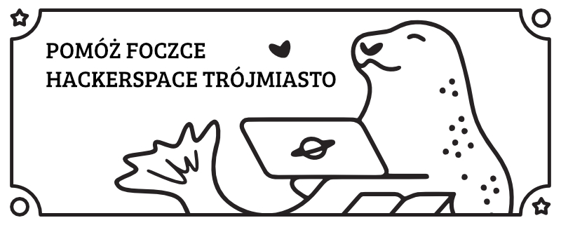
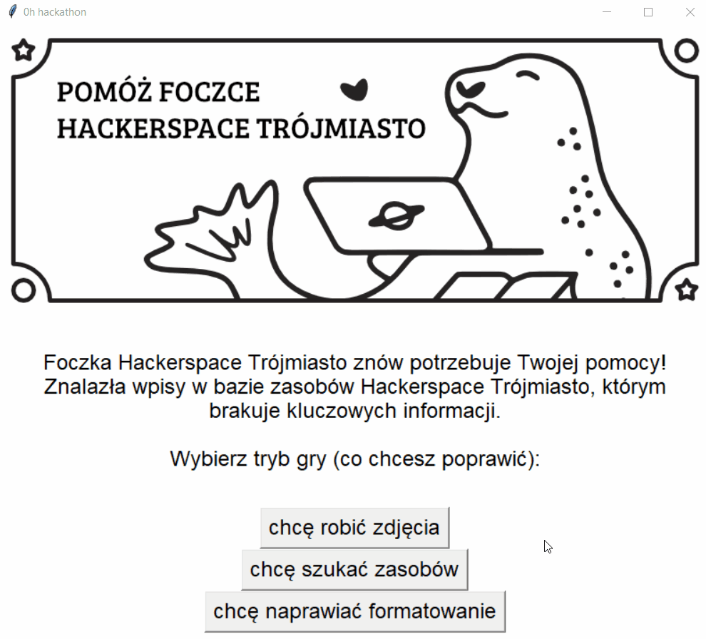

# 0h Hackathon game



Gra stworzona na [0h game jam w trolejbusie](https://illuminathon.hs3.pl/game-jam/).

Foczka Hackerspace Trójmiasto znów potrzebuje Twojej pomocy! 
Znalazła wpisy w bazie zasobów Hackerspace Trójmiasto, którym brakuje kluczowych informacji.

Wybierz jeden z trzech trybów gry i popraw posty:
- dodaj brakujące zdjęcia
- uzupełnij brakujące lub błędne miejsca
- popraw formatowanie Markdown

Foczka Hackerspace Trójmiasto będzie Ci wdzięczna! 💌

## Instrukcja

### Wymagania wstępne

- Python >=3.11
- dostęp do internetu
- konto na [forum Discourse Hackerspace Trójmiasto](https://kb.hs3.pl/c/hs3/baza-wiedzy-hackerspaceu/9) (by móc edytować posty)

### Instalacja wymagań

Opcjonalnie - stwórz [wirtualne środowisko](https://docs.python.org/3/library/venv.html).

```
pip install -r requirements.txt
```

### Rozpoczęcie gry

```
python app.py
```

### Rozgrywka

1. Wybierz tryb gry
1. Przejdź do posta i popraw go zgodnie z instrukcją (musisz się zalogować na forum)
1. Po poprawieniu z posta trzeba usunąć tag `fix-markdown`, `fix-place` lub `img-needed` - docelowo ma być to zautomatyzowane
1. Wróć do gry i wygeneruj kolejny post do poprawy lub wróć do ekranu wyboru trybu gry



## Atrybucja

- oryginalna grafika foczki "Ex Libris" - [hs3 library (!2)](https://github.com/hs3city/library/pull/2)
- ikony - [iconmonstr](https://iconmonstr.com/)